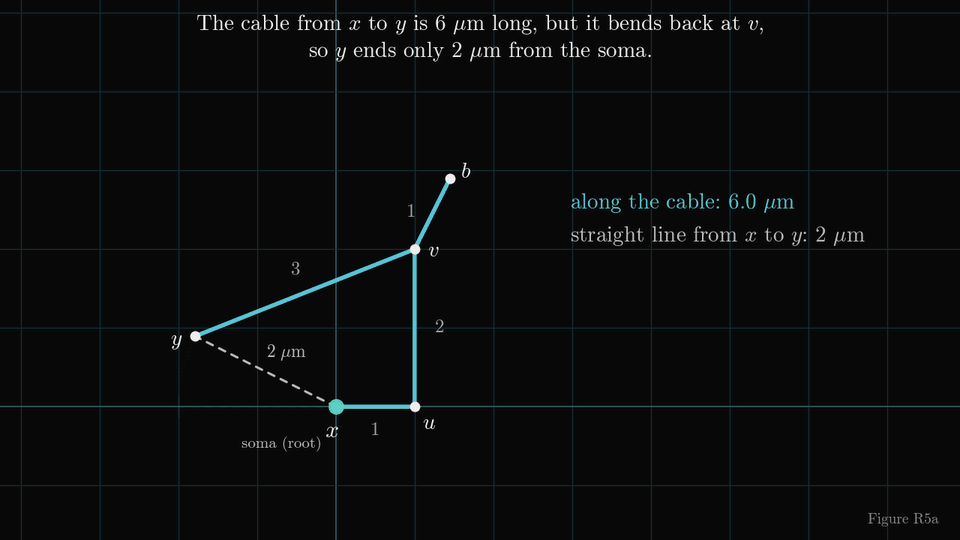

<h1 align="center">CLEARMIND</h1>

<p align="center">
  <b>Closed-Form Laplacian Embeddings of Arakelov–Green Resistance<br>for Morphological Intrinsic Neuronal Distances</b>
</p>

<p align="center">
  Yuyang Zhang, Weihan Xu, Xuehai Zhou, Shucheng Cao, Qihuang Zhang
</p>

<p align="center">
  <a href="https://arxiv.org/abs/2608.04460"><b>arXiv:2608.04460</b></a>
</p>

<p align="center">
  A training-free spectral descriptor of neuron morphology,<br>with the code and the saved results of the paper's experiments.
</p>

<p align="center">
  <a href="#the-idea-in-one-example">The idea</a> &nbsp;·&nbsp;
  <a href="#results-in-brief">Results</a> &nbsp;·&nbsp;
  <a href="#check-the-results-in-seconds">Check the results</a> &nbsp;·&nbsp;
  <a href="#repository-map">Repository map</a> &nbsp;·&nbsp;
  <a href="#data">Data</a>
</p>

<p align="center">
  
</p>

<p align="center">
  <sub>The worked example of the paper in seven frames. The full step-by-step animation is <a href="toy_example.mp4"><code>toy_example.mp4</code></a> (5 min 35 s, silent).</sub>
</p>

## The idea in one example

A neuron is a tree, so any two of its points are joined by exactly one path. A long branch can still bend back and end close to the soma, and path distances cannot tell such a branch from one of the same length that runs outward.

CLEARMIND tells them apart in three steps.

| Step | What it does | In the example above |
|---|---|---|
| **1. Close the loops** | Each tip that returns within ε of the soma is joined to the soma by a chord whose length is the straight-line distance between them. | Tip *y* ends 2 µm from the soma *x* and gets a chord. Tip *b* is 3.24 µm away and gets none (ε = 3 µm). |
| **2. Read the graph as a circuit** | Every edge is a wire whose resistance is its length. The effective resistance *M*<sub>AG</sub> between two points is the voltage drop per unit of current sent from one to the other. | The current from *x* to *y* splits between the chord (resistance 2) and the tree route (resistance 6), so *M*<sub>AG</sub>(*x*, *y*) = 1.5. |
| **3. Take the spectrum** | The descriptor is the spectrum of the matrix of pairwise effective resistances: its *K* = 64 largest eigenvalue magnitudes, padded with zeros. Nothing is trained. | The signature is (6.081, 3.687, 1.500, 0.895). An outward neuron with the same branch lengths has no loop, and its largest eigenvalue is 10.99 instead of 6.08. |

The paper proves that these quantities are tied together on every graph:

```math
M_{AG}(x, y) \;=\; d_{\Gamma}(x, y) \;-\; d_{\mathrm{Trop}}(x, y)^{2}
```

The effective resistance between two points equals their path distance minus their squared tropical distance on the tropical Jacobian of the graph, a torus built from its loops. The path distance and the effective resistance are the minimal energies of an integral and of a real unit flow, so the squared tropical distance is exactly the gap between these two energies. In the example the gap is 2 − 1.5 = 0.5. The full matrix of tropical distances therefore follows in cubic time from shortest paths and one Laplacian pseudoinverse, without lattice search.

## Results in brief

- **Expressive power.** On the BREC benchmark the spectrum separates 217 of the 400 graph pairs without training: all 213 that the Laplacian spectrum separates, plus 4 more.
- **Neuron classification.** With checkpoints selected on a separate validation fold, adding the spectrum to Tree-LSTM or MorphoGNN improves mean macro-F1 on ACT-4, JML-4 and BIL-6 in all six comparisons, and mean test accuracy in five.
- **Rotated splits.** On four rotated splits whose test folds had never been used for testing, adding the spectrum raises mean test accuracy (+0.42 to +2.60 points) and mean macro-F1 (+0.58 to +2.62 points) in all six comparisons.

## Check the results in seconds

```
pip install -r requirements.txt
```

Run every command from the repository root. The commands below need no GPU and, except for the last one, no data.

| Command | What it checks | Expected output |
|---|---|---|
| `python 1_validation_selected_backbones/paired_report.py` | Tables 5, R1 and R2 from the 90 saved runs: the fold-7 selection rule against the per-epoch logs, test accuracy and macro-F1, paired bootstrap intervals | `selection rule holds for all 45 runs` for each backbone, then the tables |
| `python 1_validation_selected_backbones/rotated_folds/report_rotations.py` | App. C.7 and Table R9 from the saved rotated-fold runs | paired differences pooled over R1-R4 and over all five splits |
| `python 3_knn_descriptors/evaluate.py select`<br>`python 3_knn_descriptors/evaluate.py test` | Tables 3, 4 and R3 to R5: cosine k-NN on every descriptor, from the saved descriptors of the 2,103 neurons | `same selections = True, largest metric difference = 0.00e+00` |
| `python 2_brec/aggin_seed_replication/summarize.py` | Tables R7 and R8 and the AG-GIN row of Table 1 from the saved per-seed counts | `total 206/400 = 51.5%` for seed 300 |
| `python 7_appendix_numerical_checks/verify_fig_r1_example.py` | The worked example of Figure R1 | `M_AG(x, y) = 1.5000`, `d_Trop(x, y)^2 = 0.5000`, eigenvalues `6.0814 -0.8949 -1.5000 -3.6865` |
| `python 7_appendix_numerical_checks/verify_exact_tropical_distance.py` | The identity above against brute-force lattice search | largest discrepancy of order 1e-14 |
| `python 7_appendix_numerical_checks/verify_propositions.py` | Nine further results of Appendix A | all errors at most 1e-9 |
| `python 2_brec/spectrum_all_relabelings.py` | BREC on all 32 relabelings of every pair (about 30 s on four CPU cores, needs the BREC file) | AG spectrum 217 / 400, Laplacian spectrum 213 / 400 |

Results are written to a `rerun/` folder next to each script by default (the rotated-fold report rewrites its four summary files in place). The outputs used in the paper are in `outputs/` and `results/`.

## Repository map

Each numbered folder has its own README with the exact commands. Table, figure and section numbers refer to the revised version of the paper.

| Folder | Reproduces | Needs |
|---|---|---|
| [`1_validation_selected_backbones/`](1_validation_selected_backbones) | Table 5, Tables R1 and R2; App. C.7 and Table R9 (`rotated_folds/`): Tree-LSTM and MorphoGNN with no AG, Submitted AG and Exact quotient AG; training, checkpoint selection on fold 7, test scoring, paired bootstrap | nothing for the tables; SWC files and one GPU to retrain |
| [`2_brec/`](2_brec) | Table 1 and App. B.3: training-free AG spectrum and Laplacian spectrum on all 32 relabelings of every BREC pair; Tables R7 and R8 and the AG-GIN row of Table 1 from the per-seed counts of the ten-seed AG-GIN run | the BREC file (spectrum only) |
| [`3_knn_descriptors/`](3_knn_descriptors) | Tables 3, 4, R3, R4 and R5: fold-7-validated cosine k-NN on every descriptor (Submitted AG, Exact quotient AG across thresholds and readout lengths, Laplacian readouts, Sholl, radial TMD, full-tree H0, five statistics, the explicit lattice pipeline); `features.npz` holds all descriptors of the 2,103 neurons | nothing for the tables; SWC files to recompute the descriptors |
| [`4_morphology_and_runtime/`](4_morphology_and_runtime) | Table R6 and the statistics of App. C.3 and C.4: extraction time by core size, new cycles and contracted bridges, what Kron reduction keeps on the training neurons, the leading eigenvalue against cable length, the scale examples, and 1-WL on BREC | nothing for Table R6; SWC files or the BREC file for the other scripts |
| [`5_spectrum_only_mlp/`](5_spectrum_only_mlp) | MLP rows of Table 5 and Table R1: an MLP on the spectrum alone, validation-selected, five seeds, with all checkpoints | nothing (CPU) |
| [`6_figures/`](6_figures) | Figures R2 to R4 and the class-wise numbers of App. C.6, with the plotted values as CSV | nothing |
| [`7_appendix_numerical_checks/`](7_appendix_numerical_checks) | numerical checks of the results of Appendix A, the worked example of Figure R1, and the numbers of Figure 1 | nothing (`make_figure1.py` reads one SWC file) |
| [`clearmind/`](clearmind) | shared code: the models and the spectral extractor of the submission (`submission_treelstm.py`, `submission_morphognn.py`); Exact quotient AG, Algorithm 1 (`exact_ag.py`); the explicit lattice baseline (`lattice_baseline.py`) | |
| [`data/`](data) | the split of every neuron (`splits.csv`), the neurons not used (`excluded.csv`), the point-cloud sampling seeds (`point_cloud_seeds.csv`), and where to put the public data | |
| [`legacy/v1_reproduction/`](legacy/v1_reproduction) | the earlier release of this repository (see [below](#earlier-release)) | |

## Data

The neuron reconstructions are public SWC files: ACT-4 from the Allen Cell Types Database, JML-4 from the Janelia MouseLight project and BIL-6 from the Brain Image Library, 2,103 neurons in total, with the 10-fold assignment of the benchmark of Chen et al. (2022). The saved descriptors, predictions and logs are enough to check the tables. The SWC files are only needed to recompute descriptors or to retrain, and [`data/README.md`](data/README.md) says where to put them. `data/splits.csv` lists every neuron with its fold, label and split.

The BREC scripts read `data/BREC/brec_v3.npy` from the BREC release (Wang & Zhang, 2024).

## Protocol of the validation-selected comparisons

For Tree-LSTM and MorphoGNN, folds 0-6 train, fold 7 alone selects the checkpoint (the earliest epoch with the highest fold-7 accuracy, patience 25, at most 150 epochs), and folds 8-9 are scored once with the fixed checkpoint of each run. The three settings of a seed share the seed, initial weights, inputs, minibatch order, optimizer and schedule, and differ only in the spectral input:

- **A, no AG**: the output of the spectral branch is replaced by zeros before fusion, so the network keeps its width and parameter count.
- **B, Submitted AG**: the extractor of the submission.
- **C, Exact quotient AG**: Algorithm 1 of the revised paper.

The optimizer and schedule, the epoch cap, the patience, the five seeds (42, 114514, 1919810, 666, 1453) and the spectral settings (ε = 20 µm, τ = 5 µm, *K* = 64) are those of the original study. To retrain everything, see [`1_validation_selected_backbones/README.md`](1_validation_selected_backbones/README.md).

## Environment

Python 3.10 with the package versions in [`requirements.txt`](requirements.txt) (PyTorch 2.1.2, CUDA 12.1). The saved outputs were produced with deterministic cuDNN settings.

## Earlier release

[`legacy/v1_reproduction/`](legacy/v1_reproduction) keeps the first public release of this repository: an installable package with a command-line pipeline for the spectrum of the original study and three downstream models (GNN, Tree-LSTM and MLP), its locked data manifests, tests and documentation. It is self-contained, with its own README, environment files and result tables, and its commands are run from that folder.

## License

Copyright (c) 2026 the CLEARMIND authors. All rights reserved. You may read the code and run it to check the reported results; any other use needs the authors' written permission. See [`LICENSE`](LICENSE).
